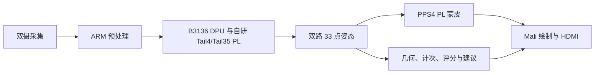

# TwinCoach

**凌视智动·双视角数字孪生教练**

基于 AMD Kria KV260 的本地双视角运动指导系统。采用双路完整 Full33 姿态识别。英文简称 **TwinCoach**，取“双视角数字教练”之意。

两台摄像头采集运动画面，板端完成姿态识别、深蹲阶段判断、计次与规范度评分，并驱动数字人和 HDMI 界面。电脑通过 SSH 控制启停，推理、几何处理、蒙皮和绘制均在板端执行。



## 功能

- 两路完整 33 点姿态，按正面和侧面观测组织运动指标。
- 深蹲动作阶段、完成计次、规范度评分和“下次建议”。
- 数字人实时跟随，画面显示实际新姿态更新 FPS；完成建议保留到下一次动作完成。
- KV260 上的 DPU、定制 PL、ARM 与 Mali 协同；Windows 仅作为控制端。

原始视频在本地处理。界面支持本地画面对照；关键点与评分仍按可能关联个人的数据管理。语音、更多动作和持续真人准确率评估作为后续工作，音频和录制默认关闭。

## 项目结构

```text
twincoach/
├── src/       应用、自研 RTL、原生模块、驱动与显示实现
├── sim/       主机测试和验证结果
├── build/     源码装配、Vivado 工程创建与构建说明
├── board/     板端启停、自检及恢复控制
├── data/      通用示例配置与汇总测量
├── skill/     可复用技能、统计脚本及使用条件
└── report/    设计、接口、动作协议、性能与协作说明
```

[设计报告](report/design.md) · [实测结果](report/results.md) · [构建与部署](build/readme.md) · [技能包](skill/readme.md) · [依赖与许可](report/third_party.md)

## 快速验证

```bash
git clone https://github.com/Westuniverse/twincoach.git
cd twincoach
python3 build/check.py
python3 skill/metrics.py data/examples/metrics.csv --start 0 --end 2
```

基础测试使用 Python 标准库，不需要开发板或模型。源码装配示例：

```bash
python3 build/stage.py --output /tmp/twincoach-runtime
```

装配后会生成 `staging.json`，列出尚需提供的模型、原生库和匹配硬件资产。完整板端运行需按 [资产说明](report/assets.md) 准备这些依赖。自研控制、运算、几何、显示和驱动源码在仓库中，模型权重、第三方 DPU IP、生成位流、人物资产、私人标定和原始画面由各自来源及授权管理，不随源码仓库分发。

## 性能与资源

测量采用录制 JPEG 输入，统计窗口为输入开始后的 15–44 秒：

| 指标 | 结果 |
| --- | ---: |
| 45 秒录像输入，热窗 15–44 秒，新姿态对确认 | 668 次 |
| 同一热窗的新姿态对更新率 | 23.034 次/秒 |
| P95 源龄 / 最大确认间隔 | 290.433 / 104.668 ms |
| 最低滚动一秒更新数 | 20 |
| di46 LUT / FF / DSP / URAM | 78404 / 115916 / 655 / 64 |
| FPGA setup / hold 裕量 | +0.017 / +0.008 ns |

这是录制 JPEG 输入、实际双 Full33 推理及 GPU/HDMI 完成确认的结果；不作为持续真人识别帧率或物理屏幕延迟。公开汇总见 [data/results.json](data/results.json)。工程创建与 BD 校验使用 Vivado 2026.1，综合资源与时序见实现报告。

## 板端控制

已部署匹配运行环境时，在 PowerShell 中执行：

```powershell
.\board\start.ps1 -BoardIP '192.168.1.100' -BoardRoot '/home/ubuntu/twincoach'
.\board\test.ps1  -BoardIP '192.168.1.100' -BoardRoot '/home/ubuntu/twincoach'
.\board\stop.ps1  -BoardIP '192.168.1.100' -BoardRoot '/home/ubuntu/twincoach'
```

双 Full33 为默认模式；混合模式是显式备选。摄像头接线与逻辑视角映射需按 [板端说明](board/readme.md) 配置。

## 许可

原创代码沿用 **GPL-2.0-only**，见 [license.txt](license.txt)。各文件中的第三方声明保留，各依赖按其独立许可使用。代码中的 `posepriv_coach`、硬件模块及固件 tag 是既有接口身份，保留以维持接口兼容；项目展示名称统一为凌视智动·双视角数字孪生教练（TwinCoach）。
