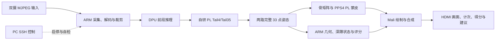

# 凌视智动·双视角数字孪生教练（TwinCoach）

## 基于 AMD Kria KV260 的本地双视角运动指导系统

参赛组别：AMD 自主选题初级组。交付版本：2026-11-02 双路 Full33 无视频版。本文以用户指定的最终运行版本为主线；研发候选与早期版本按实验边界引用。

## 1. 选题背景与目标

家庭或个人运动训练中，使用者往往难以同时观察动作深度、躯干姿态和左右对称性。单视角提供的信息与观察方向有关，单纯显示关键点也不能直接回答“做了几次”和“下一次应调整什么”。本项目选择单人深蹲作为具体场景，将双摄采集、人体姿态、运动指标、动作状态、计次评分和数字人显示组成板端闭环。

设计目标是让识别、指标计算与反馈在 KV260 上完成，电脑只负责控制；以两个方向的观测提供可解释反馈，同时保留可追溯的源身份、测量边界和接口契约。隐私价值来自原始视频在本地处理、可按场景只保留姿态与统计结果。当前演示保留本地摄像头画面，相关数据不被表述为天然匿名。

## 2. 已有工作与项目贡献

MediaPipe Pose 使用 33 个姿态关键点描述人体，本项目沿用既有模型与许可，不把预训练模型本身当作原创成果。模型背景见 [Google Pose Landmarker 文档](https://developers.google.cn/edge/mediapipe/solutions/vision/pose_landmarker)。AMD K26/KV260 提供处理器与可编程逻辑协同的平台，平台背景见 [AMD K26 页面](https://www.amd.com/en/products/system-on-modules/kria/k26.html)。

本作品的贡献集中在系统实现与工程取舍：

- 将两路完整 33 点姿态链路、深蹲语义和数字人显示连接成一个可部署的板端系统；现役链路不依赖笔记本推理。
- 在已有 B3136 DPU 基础上集成自研 Tail4/Tail35 PL 计算与 PPS4 蒙皮路径，明确第三方 IP、自研逻辑、ARM 和 Mali 的分工。
- 将正面与侧面观测用于不同的动作指标，并把“下次建议”与完成动作绑定，避免后续瞬时观测覆盖已完成反馈。
- 通过源身份、时间戳与 GPU 完成确认统计真实姿态更新，区分输入 FPS、推理吞吐、重复显示和端到端源龄。

## 3. 功能与系统框图

默认模式为两路 `full33_dpu_tail4`，混合 33+17 只作为显式备选。本版界面左侧正面、右侧侧面，数字人采用深靛蓝裤子与深绿色背景；底部显示次数、上次得分、动作阶段和新姿态更新率。

动作完成后生成“下次建议”，一直保留到下一次动作完成。暂停或丢失观测不会覆盖上一次已生成建议；重启应用会重置计次和建议。当前演示关闭音频与录制，交付中不含录像或对照视频。

## 4. 软硬件划分

| 执行位置 | 工作 | 设计依据与对应实现 |
| --- | --- | --- |
| ARM/Linux | 摄像头采集、解码调度、会话与资源管理 | src/host、src/native；动态帧率与输入源身份按既有会话管理 |
| B3136 DPU | 姿态网络前段计算 | 第三方 DPU IP 保留在 build/vendor.tar.gz，匹配模型保留在运行包 |
| 自研 PL Tail4/Tail35 | 原模型后段计算、DDR 特征搬运、控制接口 | src/rtl/tail4_*、tensor_*、head4_* 等实际工程引用文件 |
| ARM | 双视角几何、动作状态、规范度评分、骨矩阵 | src/host/posepriv_coach，与原接口契约和原始观测保持 |
| PPS4 PL | 共享加速与数字人蒙皮 | shared_pose_accel_axis*、vertex_skinning_serial_axis 等实际 RTL |
| Mali | 光栅化、绘制与画面合成 | 原生显示路径及 ARM 侧 GLES 调用 |
| Windows PC | SSH 启动、自检、停止及恢复控制 | board/ 下短名 PowerShell 入口 |

PL 已集成 ROI/DMA 相关逻辑；最终配置中 `preview_roi_crop=false`。因此不能把硬件存在的所有候选路径都写成默认运行功能。JPEG 硬件研究原型也不作为当前正式版本成果计入。

## 5. FPGA 设计与接口

目标器件为 `xck26-sfvc784-2LV-c`，硬件 tag 为 `di46ddr200_20261031`。已测工程实际引用的 44 个 HDL 输入直接提供在 src/rtl，逐文件来源列在 build/di46/sources.json。完整旧工程源码通过 维护者本地 build/restore.py 恢复，以便复用已有验证与原生构建脚本。

### 5.1 数据与控制路径

DPU 与后段计算通过 DDR 及互连连接，自研模块提供 AXI 控制与数据通路。Tail4 的 BD wrapper 显式声明 AXI4-Lite 控制接口、AXI 数据接口、低有效复位与电平中断；ROI 模块提供独立的控制及数据访问。共享加速路径通过 AXI stream 与 DMA 配合，采用既有驱动 ABI。

关键源码入口：

| 文件 | 作用 |
| --- | --- |
| tail4_operator_axi_bd_joint.v | 联合 BD 的 Tail4 接口封装 |
| tail4_operator_axi.sv、tail4_compute.sv | 运算控制与计算组织 |
| tensor_axi128_read.sv、tensor_axi128_write.sv | 128 位数据搬运路径 |
| shared_pose_accel_axis_ip.sv | 共享加速模块封装 |
| vertex_skinning_serial_axis.sv | 当前工程引用的串行蒙皮实现 |
| roi_dma_sampler_ip.sv | ROI/DMA 接口封装 |
| dpu_xrt_control_bridge_bd.v | DPU 控制桥 |

控制与数据的地址、ioctl 和寄存器契约在恢复后的 docs/interfaces.md、驱动 UAPI 与源文件中提供。功能验证沿原自检目标覆盖握手、反压、边界与数值，不以 BD 校验替代 RTL 自检。

### 5.2 时钟与时序

DPU AXI/core 为 100 MHz，DPU 2x 与 Tail4 为 200 MHz，ROI/DMA/shared 为 100 MHz；di46 将 DDR 交换与 HP0 出口设为 200 MHz。实际读回时钟及互连映射保存在 维护者保留的原导出记录（公开汇总见 data/results.json）。

本轮只整理原始实现，不改变时序约束。原 di46 首次 route 的失败与后续选中 postroute 结果分别保留；选中结果 setup +0.017 ns、hold +0.008 ns、TNS/THS 为 0。642 项 DRC warnings 也按原结果保留。

## 6. 双视角评分与显示

系统区分相机源身份、评分视角和画面标签。最终控制入口显式传评分映射，显示顺序的调整不通过重复交换原始物理输入实现，避免评分与画面相互错位。

深蹲模块根据有效观测推进动作阶段、计次并形成完成分数；分数按已有版本化指标规则生成。显示层的身体、头部与关节稳定不替换原始评分观测。界面将未开启评分、观测不足与有效结果分别呈现。

本版新增动作建议逻辑位于 src/host/posepriv_coach/compact_coach.py；进程间传递由对应几何进程模块承接。10 项测试覆盖建议保持、观测丢失、无效完成结果替换、有效建议更新、方向区分以及进程序列化。实际人体规范判别准确率未在本轮新增测量。

## 7. 优化过程与测量

每轮保留输入、版本、计时边界和结果，优先依据完整链路选择候选。不同模型模式、回放与摄像头输入分别列出。

### 7.1 最终双 Full33 结果

固定 45.019937339 秒、2698 张输入，热窗口为 15–44 秒。真实新姿态对确认 668 次，23.034483 次/s；原报告最低滚动一秒为 20，P95 源龄 290.432884 ms，最大确认间隔 104.667745 ms。该结果来自录制 JPEG 输入、实际双 Full33 推理与 HDMI/GPU 完成确认。

两路摄像头 90 秒短运行的有效输入均约 29.9 FPS，与姿态更新率分别报告。完整性能与资源表见 [results.md](results.md)，原始记录在 维护者保存的原始回放记录。

### 7.2 DDR 出口优化的取舍

相同输入和固定热窗下，di45 出口 100 MHz 时为 23.551724 次/s，di46 出口 200 MHz 时为 23.310345 次/s。局部阶段耗时下降没有转化为整链 FPS 提升，说明 ARM 与显示流水仍影响完整吞吐。本报告保留这一负结果，不使用理论带宽推导未经测量的加速比。

### 7.3 资源约束

选中 di46 使用 78404 LUT、115916 FF、139 个 BRAM36 等效、655 DSP、64 URAM，CLB 为 14629/14640，接近容量上限。因此后续架构变化需要结合资源余量、时序和完整链路收益选择。整板功耗无匹配实测，本报告不填写能效数据。

## 8. 验证与可复现性

验证按主机逻辑、RTL、实现、板端运行与材料整理分别组织：

- 原冻结与 GitHub 更新记录：3994 项主机测试（97 跳过）、77 个 RTL 目标，沿其原源码范围保留。
- 最终新增功能：10 项动作建议及进程传递测试通过，目录更名后的同类测试单独记录。
- 工程请求：8 请求共 1282960 原始字节比对全等，用于对应工程张量验证。
- 本轮材料：源码恢复、44 项硬件输入、323 项运行包映射、文件命名、控制引用与报告链接检查；使用 metrics.py 复算原始确认记录。
- 新 Vivado 创建入口：2026-11-02 在独立新目录创建成功并通过 BD 校验，exit 0；未重跑综合或实现。

复现入口见 [build/readme.md](../build/readme.md)，测试记录见 [sim/readme.md](../sim/readme.md)。完整运行包包含模型、原生库、驱动与隔离依赖，恢复到匹配基础系统即可使用现有启动入口。整体包不含工具安装环境和完整 rootfs。

## 9. 大模型协作与技能提炼

工作流为任务与指标约定、检查现有代码和测量、形成实现或候选、最小相关验证、记录结果并选择版本。真实提示词与模型可见回答节选存于 协作节选（llm.md），协作与纠错索引见 [llm.md](llm.md)。

本轮最重要的修正包括：用最终运行包修正旧首页的版本判断、发现并补收实际 XPR 的 ignored HDL 引用，以及通过显式映射处理目录更名后的旧脚本约定。技能包提供可迁移的新输出计量脚本、固件/驱动匹配方法、工具失败阶段判断和版本对齐流程，见 [skill/readme.md](../skill/readme.md)。

## 10. 交付与后续事项

工程按指南 src/sim/build/board/data/skill/report 七目录组织，使用短英文入口；Python 模块名与硬件身份保留原接口。最终运行版本不含视频，历史研究和第三方原目录放入归档。

当前交付为可审阅的本地参赛材料包。外部运行资产、提交后台最终附件条件、公开资产授权范围及决赛官方海报模板分别记录在 [gaps.md](gaps.md)，不阻塞现有工程证据与材料的归档交付。
