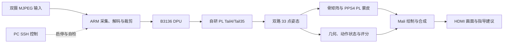

# 凌视智动·双视角数字孪生教练

**TwinCoach** 是基于 AMD Kria KV260 的本地双视角运动指导系统，将双摄姿态识别、深蹲计次与评分、数字人跟随和 HDMI 反馈连接成板端处理链路。

## 应用目标

个人训练时，使用者难以同时观察下蹲深度、躯干姿态和左右对称性。TwinCoach 利用正面与侧面的互补观测，提供动作阶段、完成次数、规则评分和下一次动作的调整建议。

原始视频在本地处理，应用可按场景只保留姿态与统计结果。界面支持本地画面对照；关键点与评分仍按可能关联个人的数据管理。

## 系统结构

默认推理模式为两路 full33_dpu_tail4。混合模式使用不同姿态链路，通过显式配置启用。

## 软硬件划分

| 执行位置 | 职责 | 实现入口 |
| --- | --- | --- |
| ARM/Linux | 采集、解码调度、会话与资源管理 | src/host、src/native |
| B3136 DPU | 姿态网络前段推理 | 外部 DPU IP 与匹配模型 |
| 自研 PL Tail4/Tail35 | 网络后段计算、DDR 特征搬运与控制 | src/rtl/tail4_*、tensor_*、head4_* |
| ARM | 双视角几何、动作状态、规范度评分与骨矩阵 | src/host/posepriv_coach |
| PPS4 PL | 共享加速与数字人蒙皮 | shared_pose_accel_axis*、vertex_skinning_serial_axis |
| Mali | 光栅化、绘制与画面合成 | src/native、src/render |
| PC | SSH 控制与自检 | board/ |

PL 包含 ROI/DMA 接口，软件通过 preview_roi_crop 选择是否使用该路径，默认关闭。

## FPGA 与接口

目标器件为 xck26-sfvc784-2LV-c。src/rtl 包含工程引用的 44 个 HDL 输入，清单位于 build/di46/sources.json。

Tail4 提供 AXI4-Lite 控制、AXI 数据访问、低有效复位与电平中断。tensor_axi128_read/write 组织 128 位数据搬运；共享加速模块通过 AXI stream 与 DMA 连接。驱动中的 UAPI 定义 ioctl、缓冲区所有权与完成语义。

| 模块 | 作用 |
| --- | --- |
| tail4_operator_axi_bd_joint.v | Tail4 的 BD 接口封装 |
| tail4_operator_axi.sv、tail4_compute.sv | 运算控制与计算组织 |
| tensor_axi128_read.sv、tensor_axi128_write.sv | 数据搬运 |
| shared_pose_accel_axis_ip.sv | 共享加速模块接口 |
| vertex_skinning_serial_axis.sv | 串行蒙皮 |
| roi_dma_sampler_ip.sv | ROI/DMA 接口 |
| dpu_xrt_control_bridge_bd.v | DPU 控制桥 |

DPU AXI/core 为 100 MHz，DPU 2x 与 Tail4 为 200 MHz，ROI/DMA/shared 为 100 MHz，DDR 交换与 HP0 出口为 200 MHz。接口约定见 [接口说明](interfaces.md)，互连取舍见 [DDR 分析](ddr.md)。

## 动作评分

正面观测提供左右对称与额状面指标，侧面观测提供深度、躯干和矢状面指标。评分使用有效的原始姿态观测；显示稳定和数字人修正独立处理。

深蹲状态机按配置的进入、退出和滞回条件识别动作阶段。完整动作形成计次与规范度评分，观测不足时给出无效状态，避免将断流前后的半次动作拼接成完整动作。

评分规则、有效观测条件与恢复策略见 [动作协议](exercises.md)。

## 数字人与反馈

界面左侧显示正面、右侧显示侧面，并呈现数字人、次数、上次得分、动作阶段与新姿态更新率。逻辑源、物理视角、评分映射与显示顺序分别配置。

动作完成后生成“下次建议”，保留到下一次动作完成。暂停或丢失观测不覆盖已经生成的建议；重启应用会重置计次与建议。反馈逻辑位于 compact_coach.py，几何进程负责跨进程传递。

## 性能与验证

在录制 JPEG 输入的固定统计窗口内，系统确认 668 次新姿态对，更新率为 23.034483 次/s，P95 源龄 290.432884 ms，最大确认间隔 104.667745 ms。

FPGA 实现使用 78404 LUT、115916 FF、139 BRAM36 等效、655 DSP 和 64 URAM，setup/hold 裕量分别为 +0.017/+0.008 ns。完整测量条件与结果见 [性能说明](results.md)。

验证覆盖主机功能测试、RTL 自检、工程创建与 BD 校验、综合实现报告和板端运行。不同验证层分别记录，测试入口见 [验证说明](../sim/readme.md)。

## 构建与扩展

公开源码可直接运行主机测试，并通过 build/stage.py 装配运行目录。板端部署所需模型、角色、原生库及固件按 [资产说明](assets.md) 准备；构建命令见 [构建说明](../build/readme.md)。

功能范围见 [scope.md](scope.md)，扩展方向见 [roadmap.md](roadmap.md)，工程方法见 [development.md](development.md)。
