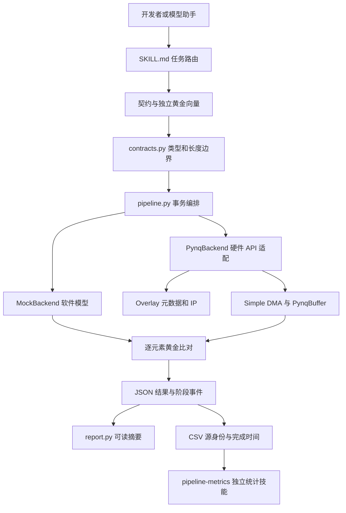
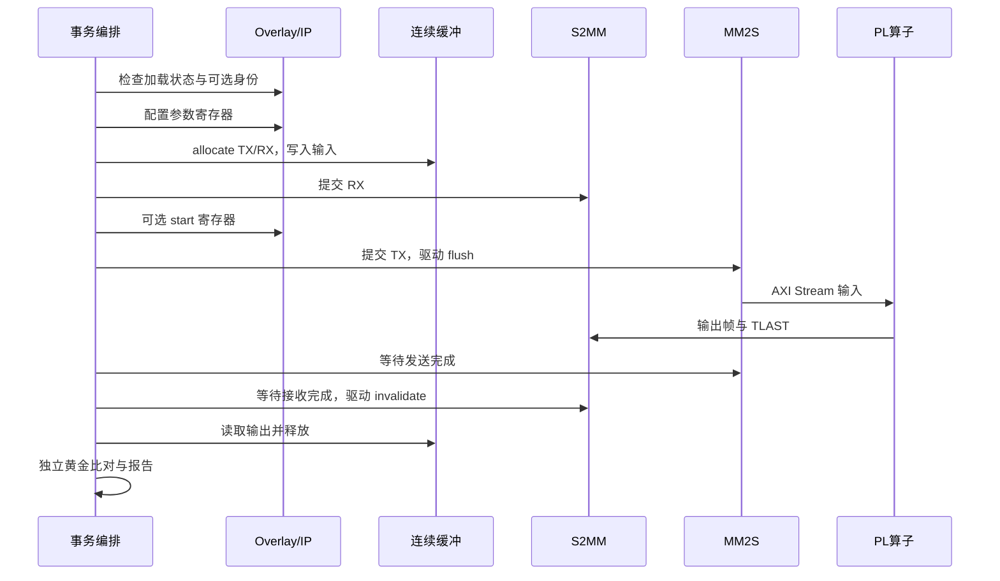

# 架构

## 目标和范围

该技能把“某块板上的一次调用”拆成可替换的接口描述、执行后端和证据格式。PYNQ 的 Overlay/IP/DMA API 是硬件适配边界，动作识别、模型、相机和 TwinCoach 目录不进入通用逻辑。

直接支持的事务为：一个 DMA 的 MM2S → 等长整型流算子 → S2MM。主机缓冲是一维数组，形状、数据类型、寄存器和独立黄金向量均显式给出。多 DMA、SG、cyclic、连续无限流和非等长输入输出需要独立扩展契约。

## 分层结构



| 层 | 负责什么 | 输入 | 输出 | 不负责什么 |
| --- | --- | --- | --- | --- |
| 任务路由 | 选择检查、运行、移植或诊断流程 | 用户意图 | 需要读取的参考与工具 | 不假定部署授权 |
| 契约 | 数据类型、帧长、总线字节数、寄存器、IP 名称 | JSON | 一次静态检查后的事务定义 | 不推测未知 IP 的语义 |
| 编排 | 调用后端、记录边界、比较独立黄金结果 | 契约与向量 | 结果 JSON、可选 CSV | 不把模型计算结果充当独立黄金 |
| 后端 | 同一 transfer 接口的不同实现 | 输入值、字节数 | 实际输出、事件 | 不改变评分或业务算法 |
| 证据 | 环境标识、数值结果和计量边界 | 执行输出 | 可读报告及统计数据 | 不推导未测量的板端指标 |

## 控制流与数据流

控制流设置参数和执行顺序；数据流搬运输入输出；证据流只观察并记录，不能影响算子的输入或黄金结果。



接收先于启动和发送，适用于算子开始后即可产生输出、内部缓冲有限的设计。需要不同握手顺序的 IP 应明确修改后端，不以静默重试补偿协议差异。

## 资源所有权

PynqBackend 持有当前事务的 TX/RX 缓冲。缓冲在成功完成后释放；发生异常时先调用 DMA 通道 stop，只有停止返回且通道不再运行时才释放。

如果停止失败，缓冲仍由会话对象保留，禁止继续提交。该行为不等于通用硬件故障恢复：PYNQ 的 wait/stop 是阻塞 API，缺少 TLAST 或异常互连可能需要操作员按对应设计恢复。不能通过强杀进程来证明 DMA 已停止。

软件模型只持有 Python 列表，没有设备地址，不访问 PL。

## 缓存职责

当前 PYNQ simple DMA 驱动在发送 transfer 时调用 TX.flush，在接收 wait 完成后调用 RX.invalidate。适配层依赖这个驱动契约，不再显式重复 flush/invalidate。

自定义 MMIO 主设备或不同 DMA 驱动不能直接继承这一假设。移植时应先确认哪个组件负责缓存发布与失效，然后把职责放在唯一明确的接口边界。

## 文件与模块

```text
pynq-pipeline/
├── SKILL.md
├── assets/
│   ├── copy.json
│   ├── copy-vectors.json
│   ├── affine.json
│   └── affine-vectors.json
├── scripts/
│   ├── contracts.py
│   ├── backends.py
│   ├── pipeline.py
│   └── report.py
└── references/
    ├── architecture.md
    ├── contract.md
    ├── workflow.md
    ├── porting.md
    ├── failures.md
    ├── validation.md
    └── prompts.md
```

模块单向依赖：pipeline → contracts/backends；report 只读结果。依赖 PYNQ 的导入位于硬件后端构造函数内，软件检查不会因为缺少 PYNQ 而失败。

## 扩展点

| 变化 | 修改位置 | 可以复用 |
| --- | --- | --- |
| IP 或层级名称不同 | 契约 dma/control.ip | 后端、比对、报告 |
| 数据类型或长度不同 | dtype/count/word_bytes/max_bytes | 编排与指标工具 |
| 参数寄存器不同 | control.writes 与 parameters | 分配、DMA 和缓存职责 |
| 不同算子 | operation 的软件参考与独立黄金向量 | 硬件后端和证据格式 |
| 不同板卡 | 外部 bit/HWH、PYNQ 环境和接口契约 | 相同 DMA/IP 语义下的工具 |
| 不同 DMA 类型 | 新后端及其所有权规则 | 契约、黄金比对和报告，不能直接沿用 simple DMA 假设 |

## 设计依据

接口错位、源文件与实际工程引用不一致、重复显示被计作新结果，以及缓存职责散落在调用层，都会使局部通过无法说明整体行为。该架构把这些问题分别放到契约、执行、所有权和证据边界处理，避免重复增加逐帧校验。
