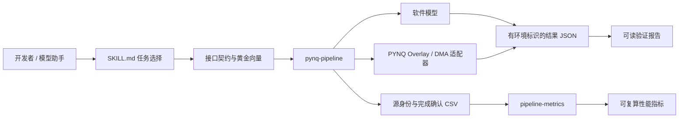

# 通用 FPGA 工作流技能包

本技能包把数据通路接入和性能计量做成可独立取用的工具。它面向开发者和模型助手，不依赖深蹲、人体模型、摄像头目录或 TwinCoach 的板端路径。

## 能力入口

| 技能 | 解决的问题 | 输入 | 输出 |
| --- | --- | --- | --- |
| [pynq-pipeline](pynq-pipeline/SKILL.md) | 如何接入并验证一个 PYNQ Overlay/简单 DMA 数据通路 | 接口契约、独立黄金向量、可选 bit/HWH | 执行结果、差异索引、阶段事件、可读报告、可选 CSV |
| [pipeline-metrics](pipeline-metrics/SKILL.md) | 如何区分输入、重复输出和真正完成的新结果 | 源身份与完成时间轨迹、固定窗口 | 新输出吞吐、P95 源龄、最大确认间隔 |

## 总体架构



**控制流**确定 IP 身份、寄存器参数和操作顺序。**数据流**负责 TX/RX 与 PL 交互。**证据流**记录环境、数值结果和完成边界，独立于业务算法。

详细的分层职责、调用顺序、缓冲所有权和扩展位置见 [PYNQ 架构说明](pynq-pipeline/references/architecture.md)。

## 目录结构

```text
skill/
├── readme.md
├── metrics.py                         项目的兼容入口
├── pynq-pipeline/                      可单独复制的 PYNQ 技能
│   ├── SKILL.md                        模型助手入口
│   ├── scripts/
│   │   ├── contracts.py                类型、长度和接口边界
│   │   ├── backends.py                 软件模型与 PYNQ 适配
│   │   ├── pipeline.py                 检查、执行、比对和轨迹
│   │   └── report.py                   结果摘要
│   ├── assets/                        两组契约与独立黄金向量
│   └── references/                    架构、契约、流程、移植、诊断和验证
└── pipeline-metrics/                   可单独复制的统计技能
    ├── SKILL.md
    ├── scripts/measure.py
    ├── assets/trace.csv
    └── references/protocol.md
```

SKILL.md 使用工具识别所需的标准名称；其他文件采用短英文名。人从本页了解体系，模型助手从各技能的 SKILL.md 按任务读取参考资料，脚本负责确定性的计算与接口调用。

## 无板卡快速使用

以下命令从项目根目录执行，不需要 PYNQ、模型或外部 Python 依赖：

```bash
python3 skill/pynq-pipeline/scripts/pipeline.py run \
  --contract skill/pynq-pipeline/assets/copy.json \
  --vectors skill/pynq-pipeline/assets/copy-vectors.json \
  --output /tmp/copy-result.json

python3 skill/pynq-pipeline/scripts/pipeline.py run \
  --contract skill/pynq-pipeline/assets/affine.json \
  --vectors skill/pynq-pipeline/assets/affine-vectors.json \
  --output /tmp/affine-result.json

python3 skill/pynq-pipeline/scripts/report.py /tmp/affine-result.json --output /tmp/affine-report.md

python3 skill/pipeline-metrics/scripts/measure.py skill/pipeline-metrics/assets/trace.csv \
  --origin-first --start 0 --end 2
```

两个算子样例分别使用 uint32 复制和 int16 仿射变换，IP 名称、层级、参数和数据均不同。软件模型的结果明确标记 hardware_executed=false；其计时不作为硬件性能。

## 如何用于其他题目

1. 复制对应技能目录。工具只读本目录中的模块与调用者提供的数据。
2. 从自己的 IP/HWH 填写 DMA、控制寄存器、类型、字节数与容量。
3. 准备独立黄金向量，先验证软件数据和报告链路。
4. 在自己的 PYNQ 环境中 inspect 元数据，获得部署授权后才显式运行硬件或下载 Overlay。
5. 保存实际结果及其输入条件，用统一 CSV 分析完成确认。

独立使用时，以技能目录为工作目录即可运行 scripts/ 中的命令。也可以将整个子目录放入 Codex 的 skills 目录；不需要复制整个 TwinCoach 工程。

## 复用边界

| 层次 | 可复用内容 | 使用者需要改变 |
| --- | --- | --- |
| 跨任务 | 契约格式、编排、PYNQ 适配、比较和报告 | 算子定义、寄存器与独立向量 |
| 跨板卡 | 兼容 PYNQ/simple DMA 语义的主机工具 | 实际 bit/HWH、板端环境、时钟和接口 |
| 跨项目计量 | CSV 身份、epoch、纳秒时间戳与公式 | 明确源和完成的物理含义 |
| 跨开发工具 | SKILL.md 指令与 CLI | 任务输入和执行环境 |

PYNQ-Z2 与 Kria 等平台不能共用位流。该技能不自动移植器件、PS 配置或约束，也不要求 TwinCoach 主链路改用 PYNQ。

## 验证与可核查性

[验证说明](pynq-pipeline/references/validation.md) 把软件模型、PYNQ API 替身、独立目录运行和实际硬件分别列出。仓库测试覆盖前三种；没有用软件模拟冒充跨板卡上板。

```bash
python3 -m unittest discover -s sim -p 'test_skill.py' -v
```

软件测试检查黄金比对、身份与类型拒绝、接收先行、驱动缓存职责、失败时停止再释放、不能停止时保留缓冲，以及复制到独立目录后的执行。

## 从工程问题提炼的规则

| 工程观察 | 提炼的能力 | 其他项目的用途 |
| --- | --- | --- |
| 目录与实际引用不一致 | 显式接口契约与独立目录检查 | 接入陌生 Overlay 或更换工程布局 |
| 参数、类型与模型输出混淆 | 独立黄金向量与逐元素差异 | 图像、信号处理或控制算子验证 |
| 采集/绘制次数不能代表新结果 | 源身份、epoch 与完成确认 | 任意异步数据流水线 |
| 缓存职责重复且所有权不明 | 驱动管理同步，事务管理缓冲 | PYNQ DMA 主机调用 |
| 单阶段结果容易被扩大解读 | 环境标签与分层证据 | 实验报告、接口调试与技术评审 |

常见失败与定位方法见 [诊断说明](pynq-pipeline/references/failures.md)，模型助手任务模板见 [prompts.md](pynq-pipeline/references/prompts.md)。

实际任务、模型处理与审查纠错的对应关系见 [协作案例](../report/collaboration.md)。
